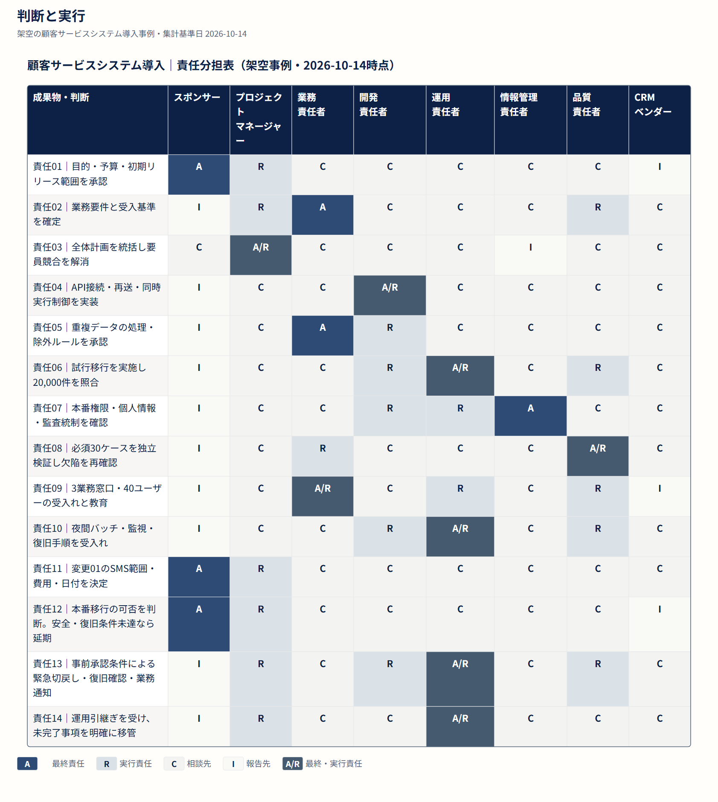

# Taskobo Diagrams

[English](README.md) · [日本語](README.ja.md) · [简体中文](README.zh-CN.md)


**煩雑な資料整理を AI に任せ、プロジェクトマネージャーは判断、対話、成果の実現に集中する。**

AI はプロジェクト管理ツールと、PM の働き方を変えていく。AI が下書きや整理を支援し、図表をチームが継続的に修正し、議論し、行動につなげるための作業資料にする。

Taskobo Diagrams は、この考えに基づいて [Taskobo](https://taskobo.com/) が進めるオープンソースの取り組みだ。

[使い方](docs/pm-skill.ja.md) · [日本語版Skillをダウンロード](https://github.com/dfzzq719/taskobo-diagrams/releases/download/pm-skill-ja-20261023/taskobo-diagrams-ja.zip) · [図表ギャラリー](docs/gallery.ja.md)

## PM と AI の役割

- **資料を準備する**：AI が提供されたプロジェクトの事実から図表の案を作り、PM が仮定、不足情報、根拠を確認する。
- **変化を議論する**：共通の図表で範囲、責任、日付を確認し、PM がトレードオフを整理して認識の違いを解消する。
- **成果につなげる**：確認済みの決定を資料に反映し、PM が担当者、受入条件、次の行動を具体化する。

## 今すぐ使える流れ

1. **ダウンロードして試す**：同梱のオフラインデモを開き、一つの計画が2回の定例会議を経て更新される流れを確認する。[使い方](docs/pm-skill.ja.md)に沿って Skill を導入する。
2. **普段の AI に整理を依頼する**：既存の計画と追加の議事録を渡し、`$taskobo-diagrams` で原文に基づく変更比較、アクション、要判断事項をまとめる。
3. **レビューして保存する**：責任、日付、変更の根拠を確認し、合意した変更を新しい状態として保存する。同じ状態から WBS、RACI、工程表を生成する。

AI が資料を読み取り、同梱ツールが検証と描画を担い、判断と確認はチームが担う。説明と図表例は3言語に対応する。公開するSkill本体、継続更新教材、レビュー画面、図表は **日本語版**だ。中国語版を保守上の基準とし、同じ処理ロジックから日本語の配布物を作る。初期公開版であり、現在の対応範囲は[検証記録](docs/quality.md)を参照する。

[日本語の図表サンプル](https://github.com/dfzzq719/taskobo-diagrams/raw/refs/heads/main/docs/downloads/taskobo-diagrams-examples-ja.zip)を利用する方法もある。[オンラインのスタイルツール](https://taskobo.com/free-tools/mermaid/)で描画し、DOCSKOBO で編集を続けられる。スタイルツールの画面は現在日本語だ。

## 一つのプロジェクト資料を全体で見る

架空の CRM 導入事例の責任分担表。範囲の決定から運用引継ぎまで、**14の活動と8つの役割**を省略せずに示す。

[](docs/assets/crm-case/ja/raci.svg)

[SVG 全体を開く](docs/assets/crm-case/ja/raci.svg)。架空の事例で、集計基準日は2026年10月14日だ。

- [WBS：範囲と受入条件](docs/gallery.ja.md#範囲と受入条件)――成果物と受入条件を確認する。
- [フロー：変更の承認](docs/gallery.ja.md#変更の承認)――変更を評価、判断、検証する。
- [工程表：納期](docs/gallery.ja.md#納期)――基準、実績、予測を比較する。
- [RACI：判断と実行](docs/gallery.ja.md#判断と実行)――誰が決め、実行し、関与するかを明確にする。

<details>
<summary>開発者向けの連携・バージョン・導入</summary>

共通パッケージは `@taskobo/diagrams` **0.1.3**、描画エンジンは **Mermaid 12.2.0**。**Node 22.12.0+** が必要だ。npm には未公開のため、[GitHub Releases](https://github.com/dfzzq719/taskobo-diagrams/releases)の該当 tarball を使うか、ソースから作成する。

```sh
git clone https://github.com/dfzzq719/taskobo-diagrams.git
cd taskobo-diagrams
npm ci
npm pack
# 利用側プロジェクトで、実際の配置に合わせてパスを調整する。
npm install ../taskobo-diagrams/taskobo-diagrams-0.1.3.tgz mermaid@12.2.0
```

[API と最小構成](docs/api.md) · [連携方法](docs/integration.md) · [互換性と更新](docs/upgrading.md)（開発資料は英語）

0.1.0、0.1.1、0.1.2、0.1.3 で保存した profile を引き続き読み込める。元のバージョン情報は保持する。オフライン Skill の更新には、最新版の再ダウンロードと再導入が必要だ。

</details>

MIT ライセンス。[ライセンス原文](LICENSE)と[第三者ソフトウェアの通知](NOTICE)を参照。Taskobo Diagrams は独立したプロジェクトであり、[Mermaid](https://github.com/mermaid-js/mermaid)と依存ソフトウェアにはそれぞれのライセンスが適用される。
