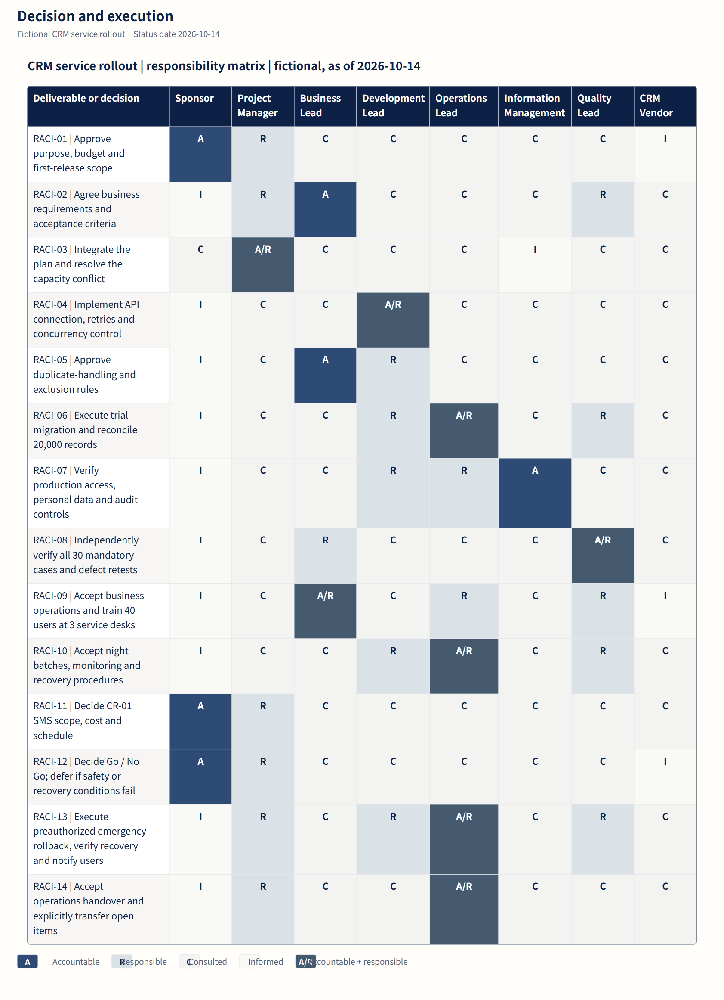

# Taskobo Diagrams

[English](README.md) · [日本語](README.ja.md) · [简体中文](README.zh-CN.md)


**Let AI handle the document work, so project managers can focus on judgment, communication and delivery.**

We believe AI will change project-management tools and the way project managers work. Let AI help draft and organize the material, and let diagrams become working documents that teams keep revising, discussing and turning into action.

Taskobo Diagrams is an open-source initiative from [Taskobo](https://taskobo.com/) built around that idea.

[Get started](docs/pm-skill.md) · [Download the Skill (Chinese Alpha)](https://github.com/dfzzq719/taskobo-diagrams/raw/refs/heads/main/docs/downloads/taskobo-diagrams-zh-CN.zip) · [Explore the gallery](docs/gallery.md)

## How project managers and AI work together

- **Prepare the material**: AI drafts diagrams from the facts you provide; the PM checks assumptions, gaps and evidence.
- **Discuss changes**: use a shared visual language for scope, responsibilities and dates; the PM organizes tradeoffs and resolves disagreements.
- **Move delivery forward**: update the material with confirmed decisions; the PM follows through on owners, acceptance criteria and next actions.

## A workflow you can use today

1. **Download and explore**: open the offline demo to see a complete plan evolve through two project meetings. Follow the [installation guide](docs/pm-skill.md) to add the Skill.
2. **Ask your own AI to organize the update**: provide the existing plan and new meeting notes. Invoke `$taskobo-diagrams` to prepare evidence-backed changes, actions and decisions to make.
3. **Review and save**: check owners, dates and supporting evidence, save the changes you have confirmed as a new state, and generate matching WBS, RACI and schedule diagrams.

AI interprets the material, the bundled tools validate and render it, and the team owns project judgment and confirmation. The guides and diagram examples are available in three languages; the current Skill and continuous-update demo remain a **Chinese Alpha**.

You can also download the [English diagram examples](https://github.com/dfzzq719/taskobo-diagrams/raw/refs/heads/main/docs/downloads/taskobo-diagrams-examples-en.zip), or draw with the [online styling tool](https://taskobo.com/free-tools/mermaid/) and continue editing in DOCSKOBO. The styling tool currently has a Japanese interface.

## See a complete project document

The fictional CRM case below retains **14 activities and 8 roles**, from scope decisions to operational handover.

[](docs/assets/crm-case/en/raci.svg)

[Open the full SVG](docs/assets/crm-case/en/raci.svg). The case is fictional, with a shared status date of 14 October 2026.

- [WBS: scope and acceptance](docs/gallery.md#scope-and-acceptance)—define deliverables and acceptance criteria.
- [Workflow: change authorization](docs/gallery.md#change-authorization)—assess, decide and verify a change.
- [Schedule: delivery dates](docs/gallery.md#delivery-dates)—compare baseline, actual and forecast dates.
- [RACI: decision and execution](docs/gallery.md#decision-and-execution)—see who decides, executes and participates.

<details>
<summary>Developer integration, versions and installation</summary>

The shared package is `@taskobo/diagrams` **0.1.3**, using **Mermaid 12.2.0**, with **Node 22.12.0+** required. It is not published to npm. Download the matching tarball from [GitHub Releases](https://github.com/dfzzq719/taskobo-diagrams/releases), or build from source:

```sh
git clone https://github.com/dfzzq719/taskobo-diagrams.git
cd taskobo-diagrams
npm ci
npm pack
# In the consuming project, adjust this path to your checkout.
npm install ../taskobo-diagrams/taskobo-diagrams-0.1.3.tgz mermaid@12.2.0
```

[API and minimal usage](docs/api.md) · [Integration](docs/integration.md) · [Compatibility and upgrades](docs/upgrading.md)

Saved profiles from 0.1.0, 0.1.1, 0.1.2 and 0.1.3 remain supported with their source version preserved. The offline Skill is a separate download; download and install it again to receive updates.

</details>

MIT licensed. See [LICENSE](LICENSE) and [third-party notices](NOTICE). Taskobo Diagrams is an independent project; [Mermaid](https://github.com/mermaid-js/mermaid) and other dependencies retain their respective licenses.
