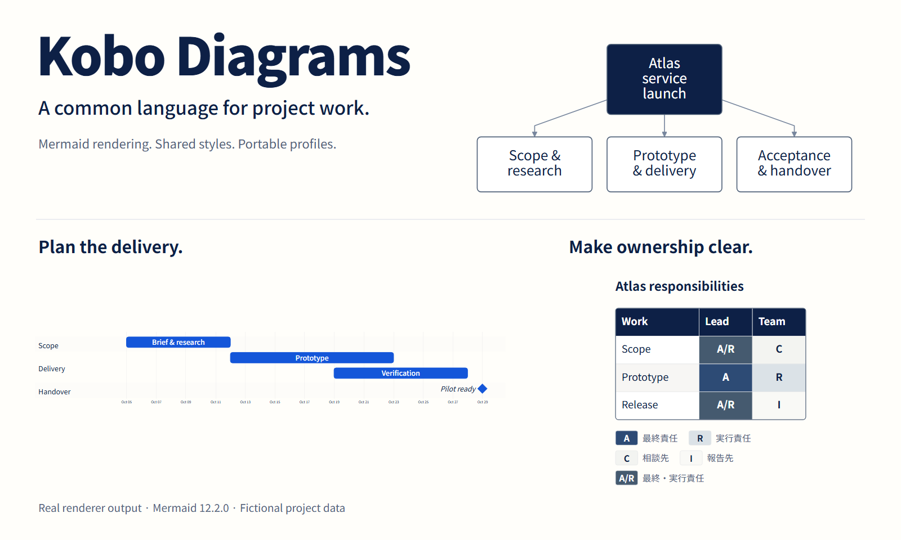
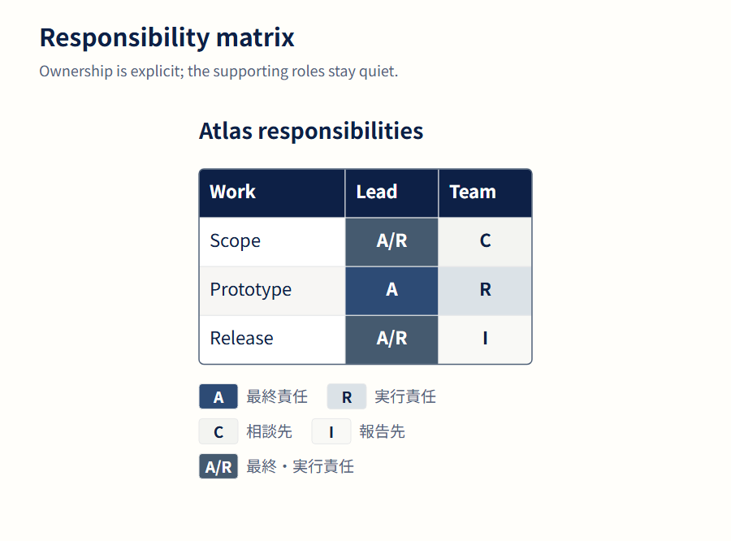
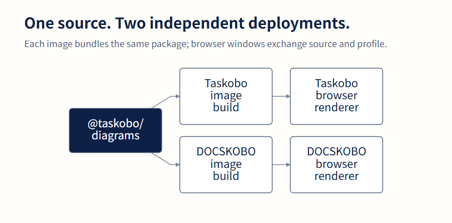

[English](README.md) · [图例与源码](docs/gallery.md) · [API](docs/api.md) · [集成说明](docs/integration.md) · [升级说明](docs/upgrading.md)

# Kobo Diagrams

**让项目文档使用共同的视觉语言。** 用同一份 profile 渲染 Mermaid 图和责任表，并把样式配置随文档带入另一个应用。

`@taskobo/diagrams` 是一个不依赖界面框架的 ESM 公共包，提取自 [Taskobo 样式配置器](https://taskobo.com/free-tools/mermaid/)，并与 [DOCSKOBO](https://docskobo.com) 共用。绘制在浏览器中完成，两个应用各自保留界面、文档存储和部署方式。

当前源码版本为 **0.1.1**，使用 **Mermaid 12.2.0**。本包**尚未发布到 npm**，请安装本地构建的 tarball，或 [GitHub Releases](https://github.com/dfzzq719/kobo-diagrams/releases) 中对应版本的文件。0.1.1 调整 RACI 展示，并接收已保存的 0.1.0 profile，保留其来源版本；本次并非 Mermaid 引擎升级。

## 可以用来做什么

| 需求 | 入口 |
| --- | --- |
| 普通 Mermaid 编辑，保留引擎支持的图种 | `createMermaidRenderer(mermaid)` |
| 共用企业配色、字体和图表增强规则 | `renderDiagram()` / `renderDocument()` |
| 把样式配置与源码一起保存、跨站传递 | `createDiagramProfile()` / `validateDiagramProfile()` |
| 把 RACI 和项目台账绘制为 SVG 表格 | `taskobo.table/v1` JSON → `renderDocument()` |

通用适配器不额外限制图种。企业绘制路径有自己的能力目录和源码规则，不同图种对各项设置的支持程度不同。**JSON 表格是 Kobo 的扩展格式，不是 Mermaid 原生语法。**

## 责任明确，层次清晰



渲染器把最强的视觉强调留给最终责任，同时保留明确的职责代码，图例与单元格采用同一配色。上图、头图和[完整图例](docs/gallery.md)均由已提交的虚构数据实际绘制。[查看原始 SVG](docs/assets/raci.svg)，或[重新生成全部图片](docs/gallery.md#reproduce-the-figures)。

## 本地运行

使用 **Node 22.12.0 或更新版本**；CI 使用 Node 24。Mermaid 是精确版本 peer dependency，应用可以显式传入并共用同一个引擎实例。

```sh
git clone https://github.com/dfzzq719/kobo-diagrams.git
cd kobo-diagrams
npm ci
npm test
npm run test:browser
npm pack
```

浏览器验证使用本机已有的 Chrome／Edge，不下载浏览器。非标准安装位置可通过 `npm run test:browser -- --browser /path/to/browser` 指定。

在消费项目中安装生成的 tarball 及对应引擎：

```sh
# 在同级的消费项目中执行；按实际位置修改 tarball 路径。
npm install ../kobo-diagrams/taskobo-diagrams-0.1.1.tgz mermaid@12.2.0
```

不使用构建工具时，在仓库根目录运行 `python -m http.server 4173 --bind 127.0.0.1`，然后打开[本地浏览器示例](http://127.0.0.1:4173/examples/browser.html)。依赖从本地加载，不使用 CDN。

## 用共同样式绘图

先在宿主页面中提供预览元素，再显式传入 Mermaid：

```html
<div id="preview"></div>
```

```js
import mermaid from 'mermaid/dist/mermaid.esm.mjs';
import {createDiagramProfile, renderDocument} from '@taskobo/diagrams';

const profile = createDiagramProfile({
  roles: {primary: '#1456D9', anchor: '#0D2046'},
  settings: {fontSize: 18, direction: 'LR'},
  standard: {name: 'Example team standard', version: '1.0'},
});
const source = 'flowchart LR\n  Plan --> Review --> Deliver';
const result = await renderDocument(source, profile.roles, profile.settings, {mermaid});
document.getElementById('preview').innerHTML = result.svg;
```

把 `source` 与 `profile` 一起保存。接收其他应用传来的配置时，先调用 `validateDiagramProfile()`，再绘制或保存。校验器保留受支持的历史来源版本，不会悄悄给旧文档换上新版本号。

普通 Mermaid 编辑器使用通用适配器，并传入应用自己的配置：

```js
import {createMermaidRenderer} from '@taskobo/diagrams';

const renderer = createMermaidRenderer(mermaid);
const result = await renderer.render(source, {
  config: {securityLevel: 'strict', htmlLabels: false},
});
const preview = document.getElementById('preview');
preview.innerHTML = result.svg;
result.bindFunctions?.(preview);
```

共用同一引擎实例的调用会进入同一队列，避免 Mermaid 的可变配置串到其他文档。该实例的绘制调用应统一经过本包。profile、图表设置、表格和 SVG／PNG 的详细说明见 [API 文档](docs/api.md)。

## 一份公共包，两个 Docker 镜像



公共包在**构建时**安装，两个镜像分别包含自己的打包副本。服务器无需设置共享可写目录，也无需增加常驻绘图服务。

两边锁定相同的公共包、Mermaid 与 lockfile，分别构建、验证镜像后再部署。文档交接需携带源码、格式、profile 和协议版本。本包负责 profile 校验，应用负责来源检查、传输和持久保存。详见[集成说明](docs/integration.md)。

## 保持更新，也让旧文档可打开

每日版本检查与 Dependabot 发现新的 Mermaid 稳定版。升级脚本同步精确依赖、lockfile 和兼容声明；测试检查版本一致性、历史 profile 及真实浏览器绘制和导出。两个消费应用仍需完成回归、构建新镜像，再进行部署。

0.1.1 接收 Mermaid **12.2.0** 对应的 **0.1.0 和 0.1.1** profile，保留已保存的 `coreVersion`，并使用当前蓝灰 RACI 规则绘制。保留 profile 的来源版本不等于新代码能逐像素复现旧输出。详见[兼容与升级规则](docs/upgrading.md)。

固定样式的离线 Agent Skill 是独立的版本化下载文件，已分发文件保持不动。接收新版核心、引擎或绘制规则，需要重新下载并安装新生成的完整 Skill 包。更新仓库或 Docker 镜像不会更新已经安装的 Skill。

## 使用边界

- Mermaid 绘图、SVG 尺寸测量和 PNG 导出需要**浏览器**。本包不是纯 Node 无头绘图服务；profile 与颜色工具可在无 DOM 环境运行。
- 本包不提供应用界面、存储、文档同步或容器部署。输入信任策略及跨站来源检查由宿主应用负责。
- 字体、浏览器和布局配置会影响输出。共用代码与 profile 可以减少差异，但不保证任意系统逐像素一致。
- 本工具包不调用 AI API；图例中的项目数据全部虚构。模板用于表达计划或职责关系，不构成项目质量认证。

## 许可证与上游归属

MIT，Copyright 2026 Taskobo contributors。详见 [LICENSE](LICENSE) 与 [NOTICE](NOTICE)。Mermaid 及传递依赖保留各自的版权与许可证；代码中的字体候选名称不代表捆绑字体文件。

Kobo Diagrams 是独立项目，**不是 Mermaid 官方项目**。[Mermaid](https://github.com/mermaid-js/mermaid) 提供基础图表引擎；本项目不声称获得项目管理机构认证。
