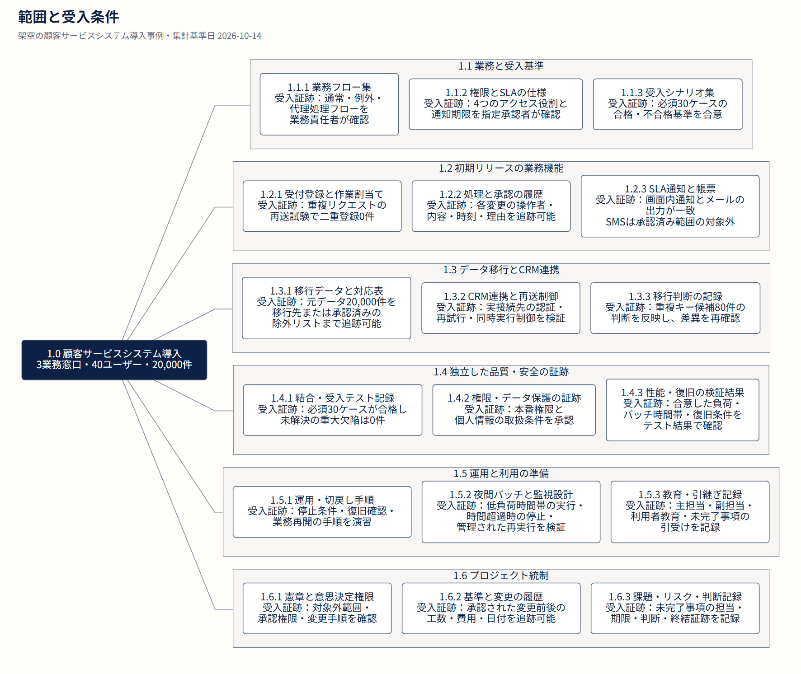
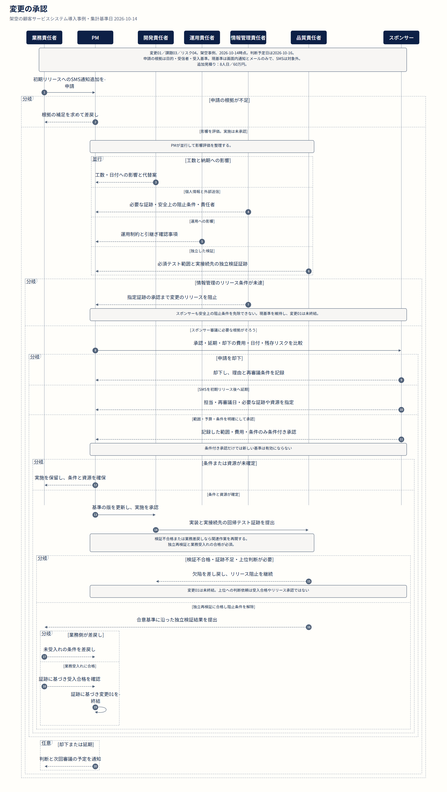
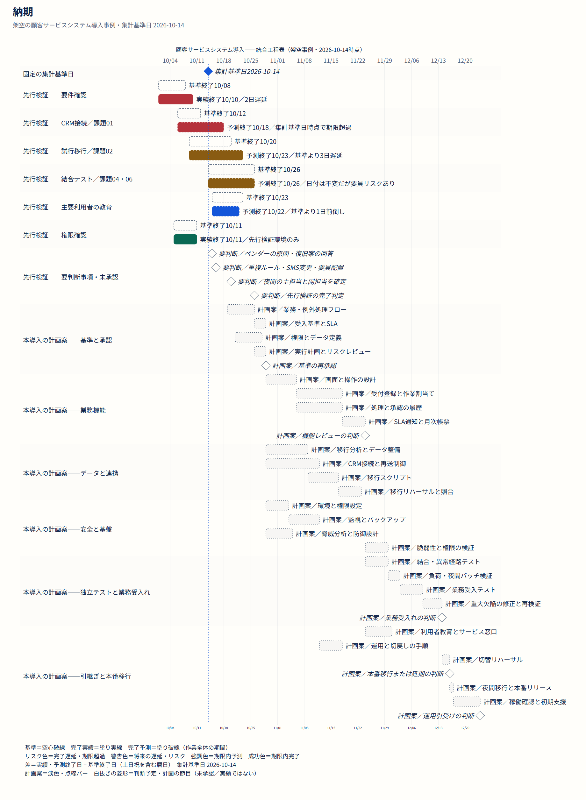

# チームで使い続けられるプロジェクト図表

[English](gallery.md) · [日本語](gallery.ja.md) · [简体中文](gallery.zh-CN.md)

[理念と使い方](../README.ja.md) · [日本語サンプルをダウンロード](https://github.com/dfzzq719/taskobo-diagrams/raw/refs/heads/main/docs/downloads/taskobo-diagrams-examples-ja.zip)

一つの架空の顧客サービスシステム導入事例を、4種類の図表で見る。範囲、責任、変更、日付の認識をそろえる。画像を選ぶと SVG 全体が開く。

## 範囲と受入条件

範囲を成果物に分解し、作業パッケージごとに受入条件を明確にする。

[画像全体](assets/crm-case/ja/wbs-figure.png) · [編集用ソース](../examples/project-case/ja/wbs.mmd)

## 判断と実行

誰が判断し、実行し、相談を受け、報告を受けるかを明確にする。

[画像全体](assets/crm-case/ja/raci-figure.png) · [編集用ソース](../examples/project-case/ja/raci.json)

## 変更の承認

範囲の変更を評価、承認、独立再検証、業務受入れにつなげる。

[画像全体](assets/crm-case/ja/workflow-figure.png) · [編集用ソース](../examples/project-case/ja/change-control.mmd)

## 納期

基準、実績、予測、未承認の後続計画を区別する。

[画像全体](assets/crm-case/ja/gantt-figure.png) · [編集用ソース](../examples/project-case/ja/schedule.mmd)
