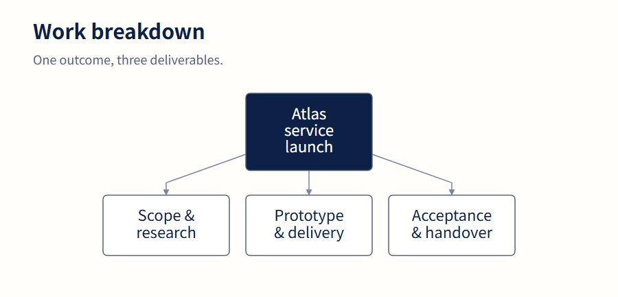
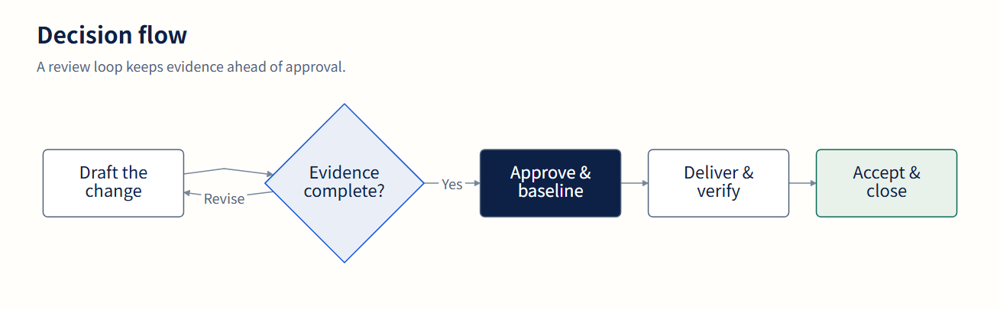
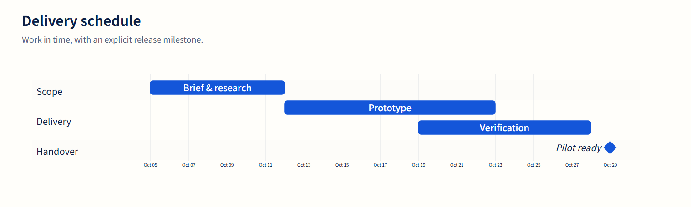

# A shared visual language, in actual output

The figures below are rendered by `@taskobo/diagrams` 0.1.1 with Mermaid 12.2.0. They share one versioned profile and fictional Atlas project data. No figure is an invented application screenshot or AI-generated image.


[Vector composition](assets/showcase.svg) · [Standalone gallery](assets/showcase.html) · [Exact inputs](assets/showcase-inputs.json) · [Output hashes](assets/showcase-manifest.json)

## Decompose the outcome



The four-node example keeps the outcome and deliverables legible. WBS here is expressed as a Mermaid flowchart; the toolkit does not introduce a new native WBS grammar. [Original SVG](assets/wbs.svg).

## Show the decision



The review loop is visible in the same diagram as the approval path. This is a fictional process model, not a claim that these controls ran. [Original SVG](assets/workflow.svg).

## Put the work in time



Fixed dates make the figure reproducible. This sample is a plan, not measured progress. The package also includes optional baseline/actual/forecast Gantt treatments; this compact figure uses ordinary Mermaid task and milestone syntax. [Original SVG](assets/gantt.svg).

## Make ownership explicit


Accountable assignments lead; supporting roles recede. The table and its legend use the renderer's actual blue-gray palette. The renderer's built-in legend has Japanese role labels, as shown; role codes remain A, R, C, I and A/R. The table uses the Kobo-specific `taskobo.table/v1` JSON format. [Original SVG](assets/raci.svg).

## Share code across deployments


The diagram describes code distribution and browser handoff, not shared server storage. The applications own transport, origin checks and persistence. [Original SVG](assets/architecture.svg) · [Integration guide](integration.md).

## Reproduce the figures

From the source repository, install the locked dependencies and use an installed Chrome/Edge:

```sh
npm ci
node scripts/build-showcase.mjs

# Optional nonstandard browser location:
node scripts/build-showcase.mjs --browser /path/to/chrome
```

The dependency-free generator starts a loopback server, calls the real browser renderer, writes original SVGs and composed proof sheets, then captures PNGs. It downloads no browser, uses no CDN and invokes no AI API. All deliverable assets are written to `docs/assets/`; the temporary headless-browser profile is removed at the end.

`showcase-inputs.json` records exact source, profile options and the normalized profile. `showcase-manifest.json` records renderer versions and SHA-256 hashes. PNG metadata records its generator and input hash. Browser and system font differences can alter raster pixels; reproduce in a controlled browser/font environment when exact visual comparisons matter.

The figures are GitHub documentation assets. Runtime tarballs include the written documentation without these large showcase images. The source generator remains available in the repository. Retain [upstream attribution](../NOTICE) when redistributing dependencies as applicable.
