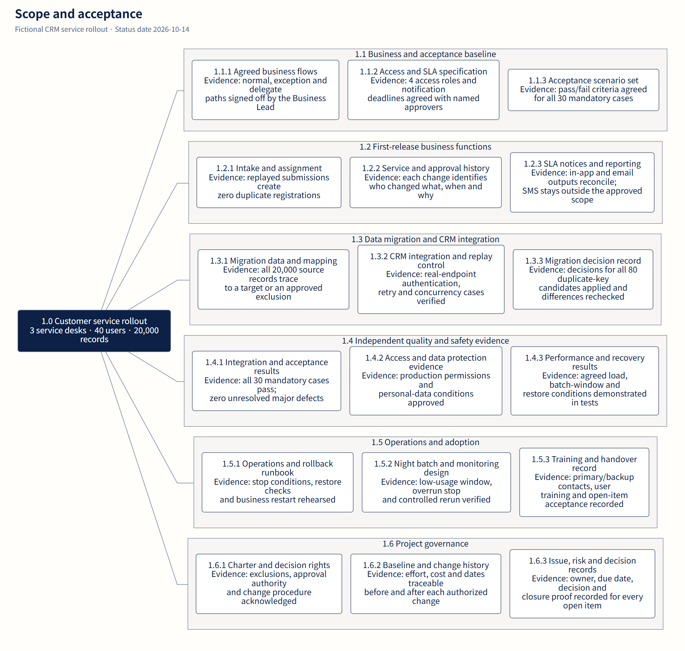
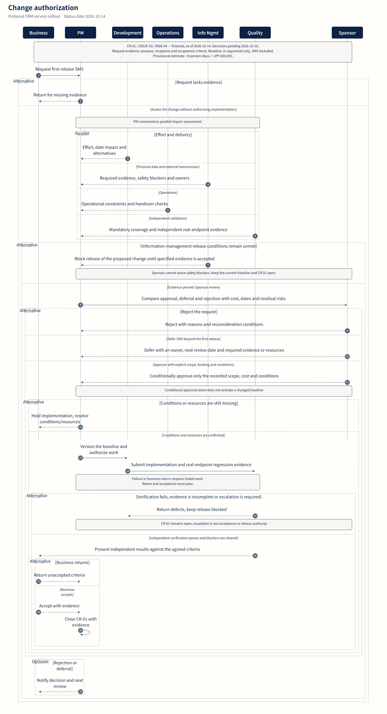
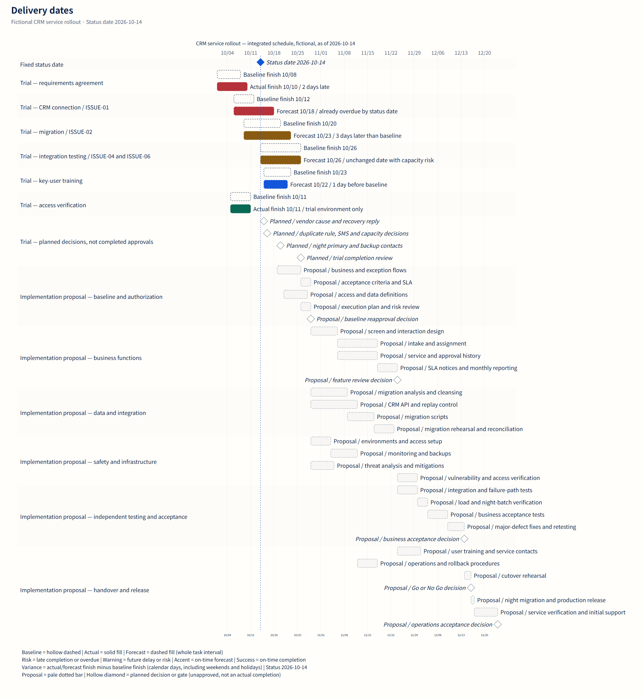

# Project diagrams your team can work with

[English](gallery.md) · [日本語](gallery.ja.md) · [简体中文](gallery.zh-CN.md)

[Project vision and use](../README.md) · [Download English examples](https://github.com/dfzzq719/taskobo-diagrams/raw/refs/heads/main/docs/downloads/taskobo-diagrams-examples-en.zip)

One fictional CRM service rollout, four diagram types to align scope, responsibilities, changes and dates. Select an image to open the full SVG.

## Scope and acceptance

Break scope into deliverables with explicit acceptance evidence.

[Full image](assets/crm-case/en/wbs-figure.png) · [Editable source](../examples/project-case/wbs.mmd)

## Decision and execution

Make accountability, execution, consultation and information explicit.

[Full image](assets/crm-case/en/raci-figure.png) · [Editable source](../examples/project-case/raci.json)

## Change authorization

Assess, authorize, independently verify and accept a change.

[Full image](assets/crm-case/en/workflow-figure.png) · [Editable source](../examples/project-case/change-control.mmd)

## Delivery dates

Distinguish baselines, actuals, forecasts and unapproved proposals.

[Full image](assets/crm-case/en/gantt-figure.png) · [Editable source](../examples/project-case/schedule.mmd)
