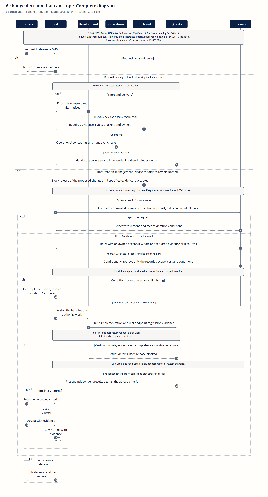

# 图表示例

[English](gallery.md) · [安装与使用](../README.zh-CN.md)

同一个虚构 CRM 项目，展示四种不同的图表。点击图片查看完整 SVG，源码可直接编辑。

[WBS](#范围与验收) · [RACI](#决策与执行) · [流程](#变更授权) · [日程](#交付日期)

## 范围与验收

**WBS** · 6 个交付群、18 个工作包，每项包含交付物与验收条件。

[完整 SVG](assets/crm-case/wbs.svg) · [源码](../examples/project-case/wbs.mmd) · [局部放大](assets/crm-case/wbs-detail.png)

## 决策与执行

**RACI** · 14 项活动 × 8 个角色，区分最终责任、执行、咨询与告知。

[完整 SVG](assets/crm-case/raci.svg) · [源码](../examples/project-case/raci.json) · [局部放大](assets/crm-case/raci-detail.png)

## 变更授权

**变更时序** · 包含并行影响分析、缺证退回、批准／延期／拒绝及独立复验。

[完整 SVG](assets/crm-case/workflow-compact.svg) · [源码](../examples/project-case/change-control.mmd) · [局部放大](assets/crm-case/workflow-compact-detail.png)

## 交付日期

**甘特日程** · 47 项日程，区分基准、实绩、预测与尚未批准的计划案；状态日为 2026 年 10 月 14 日。

[完整 SVG](assets/crm-case/gantt.svg) · [源码](../examples/project-case/schedule.mmd) · [局部放大](assets/crm-case/gantt-detail.png)

需要完整业务背景时，再看[案例说明](project-case.md)。附加台账：[风险源码](../examples/project-case/risk-register.json) · [问题源码](../examples/project-case/issues.json)。
