# 同一个 CRM 项目的六份工作材料

[English](gallery.md) · [中文 README](../README.zh-CN.md) · [案例说明](project-case.md) · [案例源码](../examples/project-case/)

案例全部虚构：客户服务 CRM 导入覆盖 **3 个业务窗口、40 名使用者和 20,000 条记录**，统一状态日为 **2026 年 10 月 14 日**。完成实绩、完成预测、尚未批准的正式实施计划案分别标示。六份材料使用同一事实、角色名称、问题编号和样式 profile。

每节先展示**完整输出**并提供原尺寸 SVG／PNG，再展示**从同一 SVG 裁出的可读局部**。表格局部把同一批行按列组排列，并带原表头，保留完整的责任和证据列；这些是完整输出的观察视窗，没有换成更小的源码。需要逐项阅读整份材料时，打开原尺寸 SVG。

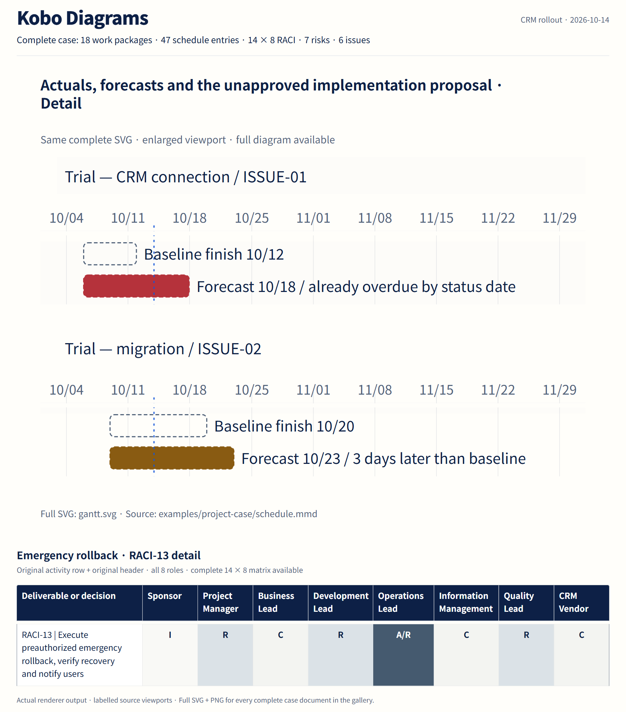

[本地 HTML 画册文件](assets/crm-case/showcase.html) · [准确绘制输入](assets/crm-case/inputs.json) · [输出清单](assets/crm-case/manifest.json) · [图片检查记录](assets/crm-case/qa.json)

在 GitHub 中，直接查看每节的完整 SVG／PNG。HTML 画册需按下方命令在本地启动仓库服务；GitHub 显示该 HTML 文件的源码。

## 范围与验收

**需要判断：首版每项交付目标，是否都有可验收的成果物？**

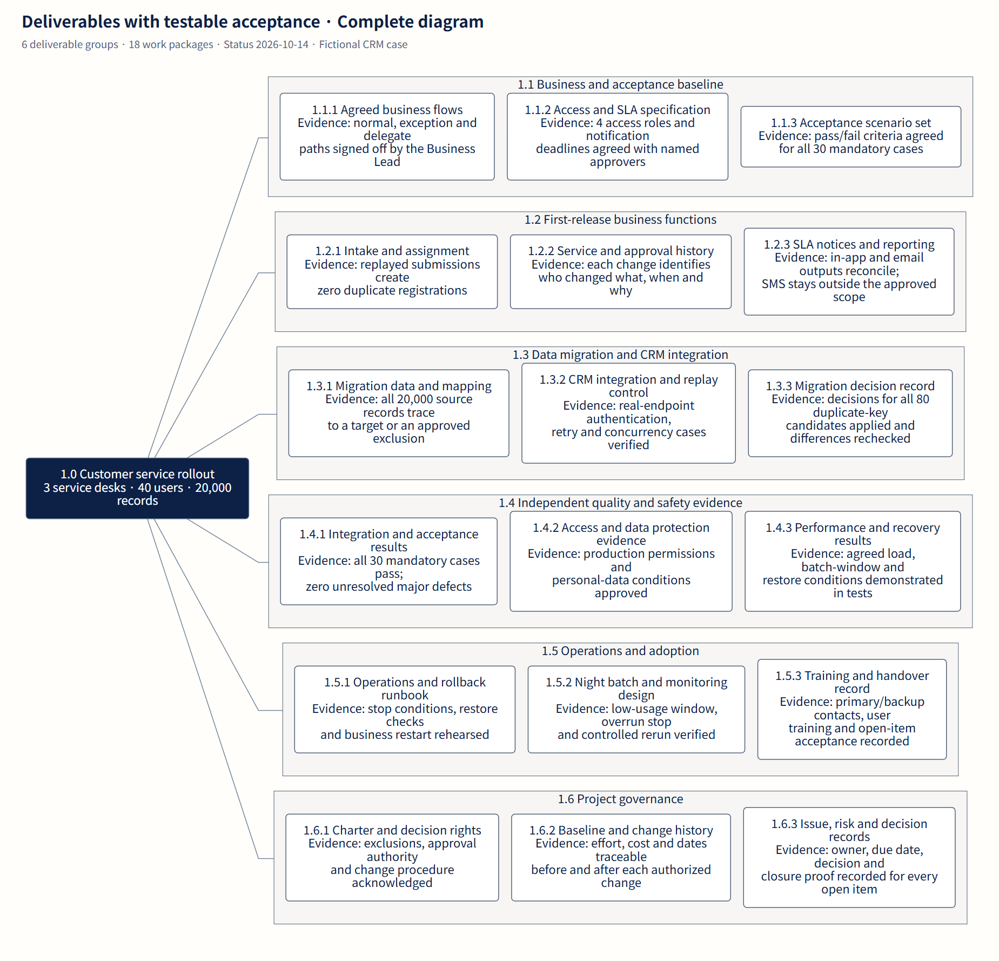

[完整 SVG](assets/crm-case/wbs.svg) · [完整 PNG](assets/crm-case/wbs-figure.png) · [WBS 源码](../examples/project-case/wbs.mmd)

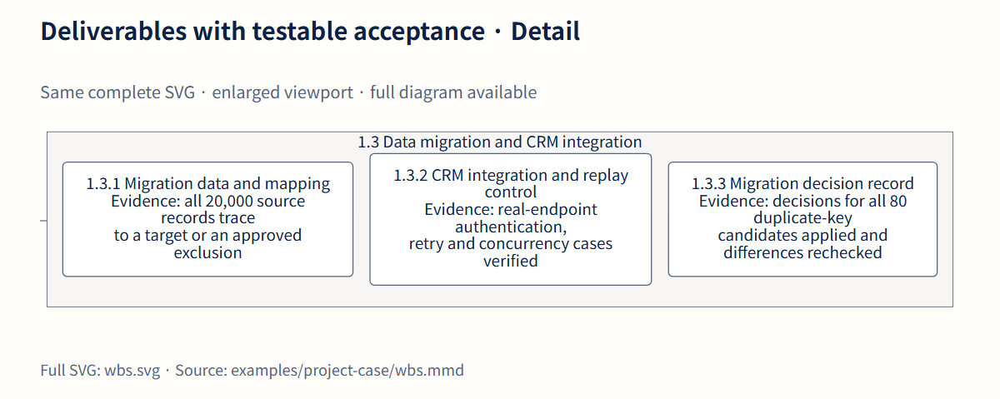

**6 个交付群、18 个工作包**把仅按功能列计划时容易漏掉的工作显露出来：移行规则决定、本番权限证据、恢复试验、监控和交接。图中连线表示成果物包含关系；任务启动条件要结合日程和决策流程阅读。

将 **1.3.2** 与 **ISSUE-01** 对照：需要真实 CRM 端点的认证、重送和并发验证证据，mock 不能满足该交付条件。将 **1.3.3** 与 **ISSUE-02** 对照：80 条重复键候选需要逐项规则决定和再次照合。**1.2.3** 当前只含站内通知与邮件；短信走 **CR-01**，提出要求本身不会把它变成已批准工作包。

**下一步：**与 Business Lead 确认范围边界，再检查责任矩阵、日程和台账是否覆盖每个工作包的验收证据。

## 变更授权

**需要判断：凭什么证据、由谁授权，才能改变当前基准？**

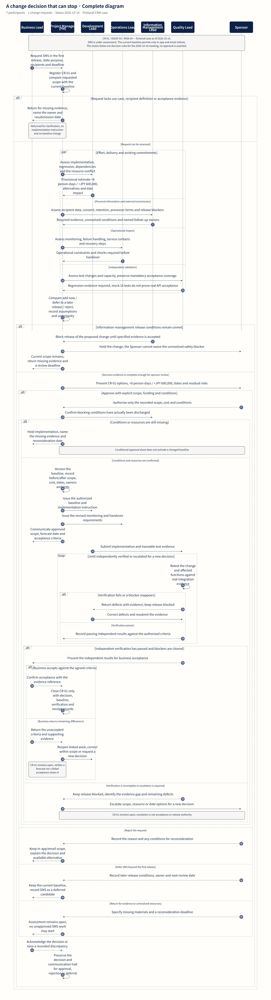

[完整 SVG](assets/crm-case/workflow.svg) · [完整 PNG](assets/crm-case/workflow-figure.png) · [变更流程源码](../examples/project-case/change-control.mmd)

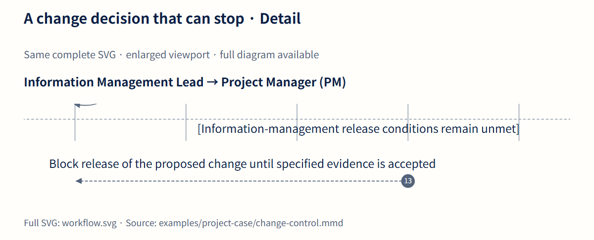

**CR-01／ISSUE-03／RISK-04**指向同一短信追加要求。**增加 8 人日／60 万日元**是提交 **10 月 16 日**评审的暂定影响估算。流程要求在 Sponsor 决定前，查清交期与资源、收件人数据条件、运维变化和独立验证覆盖。

授权需要明确范围、费用和附加条件；条件与资源落实后才调整基准。拒绝与延期也要记录理由、通知轨迹和再次评审条件。Sponsor 的决定本身不能解除尚未满足的信息管理阻断条件。

**下一步：**形成变更证据，比较首版追加、后续版本处理和拒绝三种方案，记录真正发生的决定。在要求尚未解决时，保持首版 WBS 和日程基准。

## 交付日期

**需要判断：哪项日期已经错过，哪些风险仍在前方？**

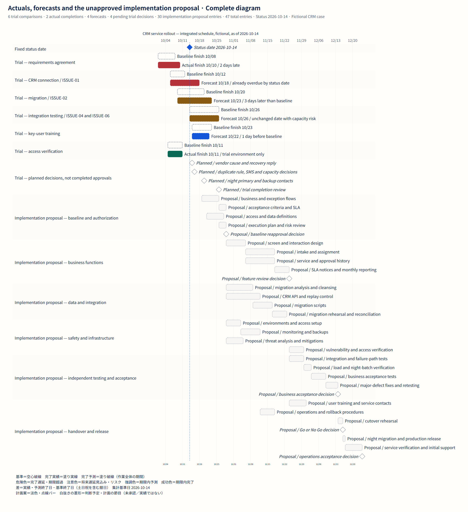

[完整 SVG](assets/crm-case/gantt.svg) · [完整 PNG](assets/crm-case/gantt-figure.png) · [日程源码及状态元数据](../examples/project-case/schedule.mmd)

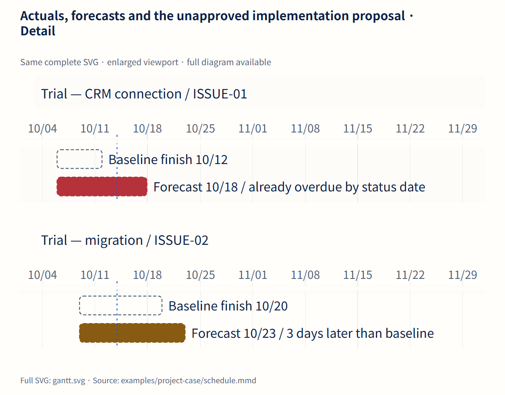

| 先行工作 | 完成基准 | 状态日所报完成时间 | 10 月 14 日的读法 |
| --- | --- | --- | --- |
| 需求合意 | 10 月 8 日 | **实绩：10 月 10 日** | 已完成，比基准晚 2 个日历日 |
| CRM 连接 | 10 月 12 日 | **预测：10 月 18 日** | 已超期；ISSUE-01 的 401 尚未解决 |
| 试行移行 | 10 月 20 日 | **预测：10 月 23 日** | 预计晚 3 日，基准日仍在状态日之后 |
| 先行集成测试 | 10 月 26 日 | **预测：10 月 26 日** | 日期未变，但资源风险尚未解决 |
| 关键用户培训 | 10 月 23 日 | **预测：10 月 22 日** | 预测提前，不等于培训已经完成 |
| 先行权限验证 | 10 月 11 日 | **实绩：10 月 11 日** | 仅限先行环境的验证通过 |

四个评审标记表示预定判断日期，不表示已经批准。完整图还保留从 10 月 19 日至 12 月的 **30 项正式实施计划案，其中含 5 个里程碑**。日期沿用原依赖计算；先行工作的延误尚未自动形成获批新基准。期间单位为日历日，不能读成人日或完成百分比。

**下一步：**用 **b_api/f_api**、**b_migration/f_migration**追查预测影响；在接受集成测试预测前，解决 ISSUE-04 的 **3 人日**缺口。若前提不成立，要重新评估后续日期并申请再批准。

## 决策与执行

**需要判断：谁承担最终责任、谁执行、谁提供受入证据？**

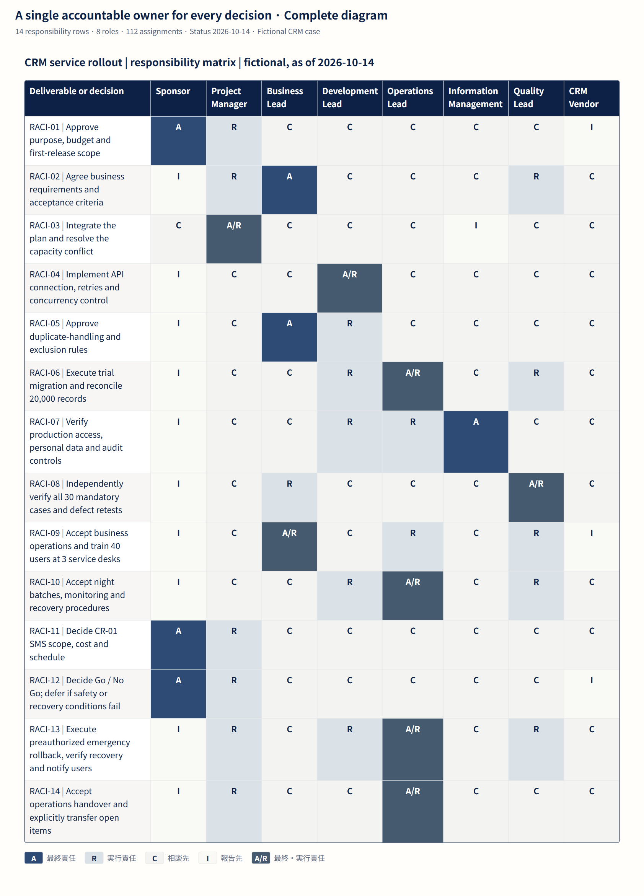

[完整 SVG](assets/crm-case/raci.svg) · [完整 PNG](assets/crm-case/raci-figure.png) · [RACI 源码](../examples/project-case/raci.json)

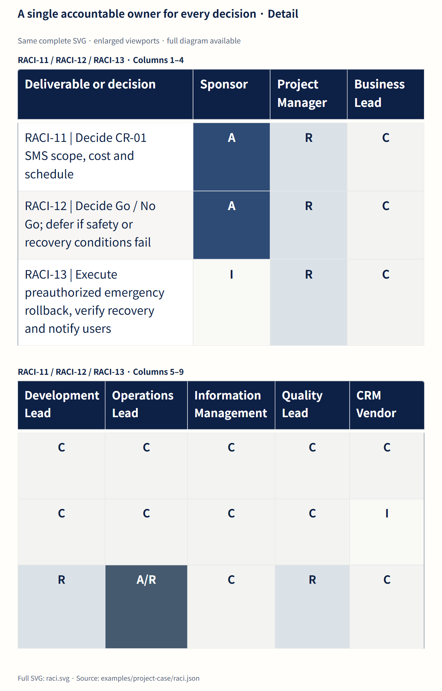

源码和完整图保留全部 **14 项活动、8 个角色**：Sponsor、Project Manager（PM）、Business Lead、Development Lead、Operations Lead、Information Management Lead、Quality Lead、CRM Vendor。每行恰有一个最终责任分配，至少一个执行责任分配。**C 表示咨询，不表示共同拥有另一份 A。**

**RACI-11**将短信决定的 A 交给 Sponsor、R 交给 PM；**RACI-04**把 API 实施的 A/R 交给开发，厂商为 C；**RACI-05**把重复键规则的 A 交给业务。**RACI-08**由质量承担独立验证的 A/R，业务承担 R，开发的完成报告仍须经过这道独立验证。

再比较 **RACI-12**与 **RACI-13**：Sponsor 对 Go／No Go 负责，运维则对获授权的紧急切回、恢复验证和通知承担 A/R。两种决定各有触发条件。**RACI-14**还要求完成运维交接，并明确移交未关闭事项。

深蓝突出最终责任，柔蓝突出执行责任，轻灰用于辅助职责；职责代码承载语义，图例与单元格使用同一配色。渲染器内置职责图例为日文。该矩阵采用 Kobo 扩展格式 `taskobo.table/v1` JSON。

**下一步：**把范围、照合、独立受入和运维就绪等行，与其他材料的负责人和关闭证据逐项对照。

## 风险触发器

**需要判断：哪种可观察事件出现后，必须在未来后果发生前采取行动？**

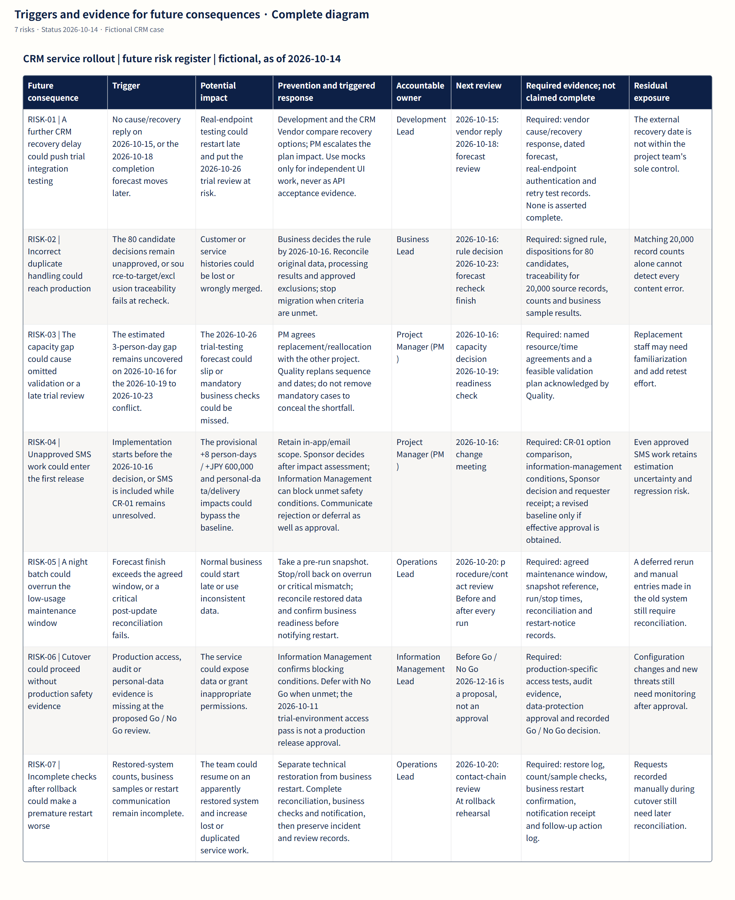

[完整 SVG](assets/crm-case/risk.svg) · [完整 PNG](assets/crm-case/risk-figure.png) · [风险台账源码](../examples/project-case/risk-register.json)

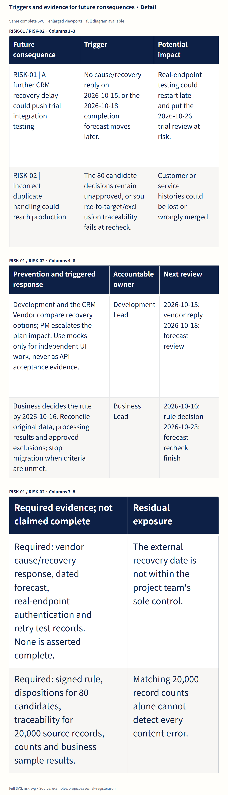

**401 已经发生**，属于 ISSUE-01；厂商恢复再次延迟，才是需要设置触发器和应对的未来风险。同样，80 条重复键候选是已发生的照合问题，未解决差分、也未批准除外就切换，才是必须防止的后果。

七行各自接到具体动作：**RISK-01**升级厂商恢复再延期，**RISK-02**阻止重复键规则未解决时移行，**RISK-03**保护测试资源，**RISK-04**控制未授权短信工作；**RISK-05**处理批处理超窗与关键照合失败，**RISK-06**处理本番安全证据不足，**RISK-07**防止切回后过早恢复服务。

例如，厂商在 10 月 15 日仍无恢复答复，或 10 月 18 日预测再延期时，开发与厂商比较恢复方案，PM 升级交期影响。批处理超窗或关键照合失败则触发停止作业或获授权切回，再验证恢复结果、通知业务后重启。这是不同的“触发器—动作”组合，需要分别判断。

**下一步：**在规定检查点复核触发器；条件出现时，创建或更新关联问题。确认相应动作已获授权，还是仍需 Sponsor 决定。

## 问题与关闭

**需要判断：除了改状态标签，什么证据能真正关闭一个已发生问题？**

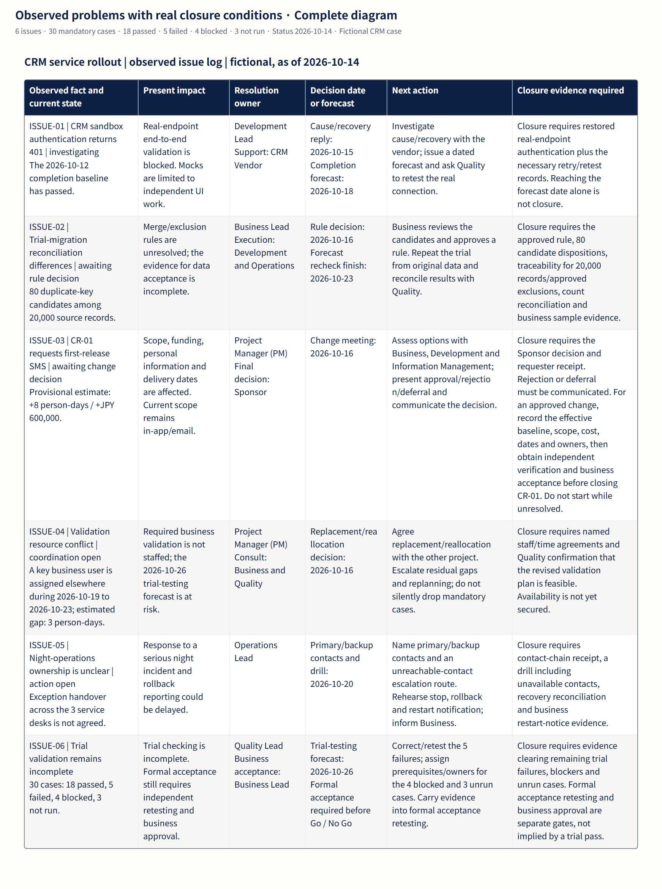

[完整 SVG](assets/crm-case/issues.svg) · [完整 PNG](assets/crm-case/issues-figure.png) · [问题台账源码](../examples/project-case/issues.json)

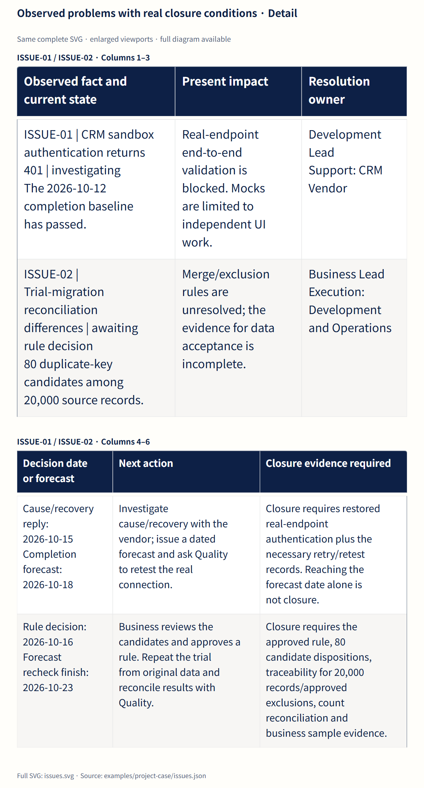

问题台账记录需要处理的事实。**ISSUE-01**需要厂商与开发在 **10 月 15 日**前答复原因和恢复方案，并完成真实端点验证；**10 月 18 日**仍是预测。**ISSUE-02**需要在 **10 月 16 日**前决定重复键规则，再次照合预计在 **10 月 23 日**结束。**ISSUE-03**要通过 CR-01 的决定与通知闭环，拒绝或延期也属于需要留痕的处理结果。

**ISSUE-04**要求给 **3 人日**缺口落实具体人员和时间，并由质量确认调整后的验证计划可行。**ISSUE-05**要在 **10 月 20 日**前形成主／备联络、联络不到人的演练、恢复检查和重启通知证据。**ISSUE-06**跟踪全部 **30 用例：18 通过、5 失败、4 阻塞、3 未执行**；消化先行缺口之后，正式受入复验和业务批准仍是独立门槛。

先行权限验证通过的适用范围仍限于该环境；本番证据要继续对照 RISK-06 与工作包 1.4.2。

**下一步：**关闭问题前，检查关闭证据字段及关联工作包；将尚未消除的后果带入风险复核和下一次上线判断。

## 使用与重新生成

安装锁定依赖后，运行案例语义检查和图片生成器。生成器使用本机已安装的 Chrome／Edge：

```sh
npm ci
node examples/project-case/verify.mjs
node scripts/build-showcase.mjs

# 浏览器位于非标准位置时：
node scripts/build-showcase.mjs --browser /path/to/chrome
```

本地编辑、查看和导出六份完整案例：

```sh
python -m http.server 4173 --bind 127.0.0.1
# 打开 http://127.0.0.1:4173/examples/browser.html
# HTML 画册：http://127.0.0.1:4173/docs/assets/crm-case/showcase.html
```

浏览器示例默认打开完整 RACI。图片生成器使用 **core 0.1.2／Mermaid 12.2.0**绘制已提交源码，保存完整 SVG，再从相同输出生成标明范围的局部图。0.1.2 改善企业表格与流程图的英文换行，以及甘特分区标题间距；表格继续保留中日韩文字处理和显式换行。[案例清单](../examples/project-case/case-manifest.json)登记六份文档，[共同事实](../examples/project-case/scenario.json)保留统一口径；图片旁提供输入、版本和哈希记录。

这些案例图片属于配套 core 0.1.2 的仓库展示材料。既有发布包与已经安装的离线 Skill 保留原文件，消费应用需要安装新包才能收到排版修复。部署与跨站交接架构另见[集成说明](integration.md)。
