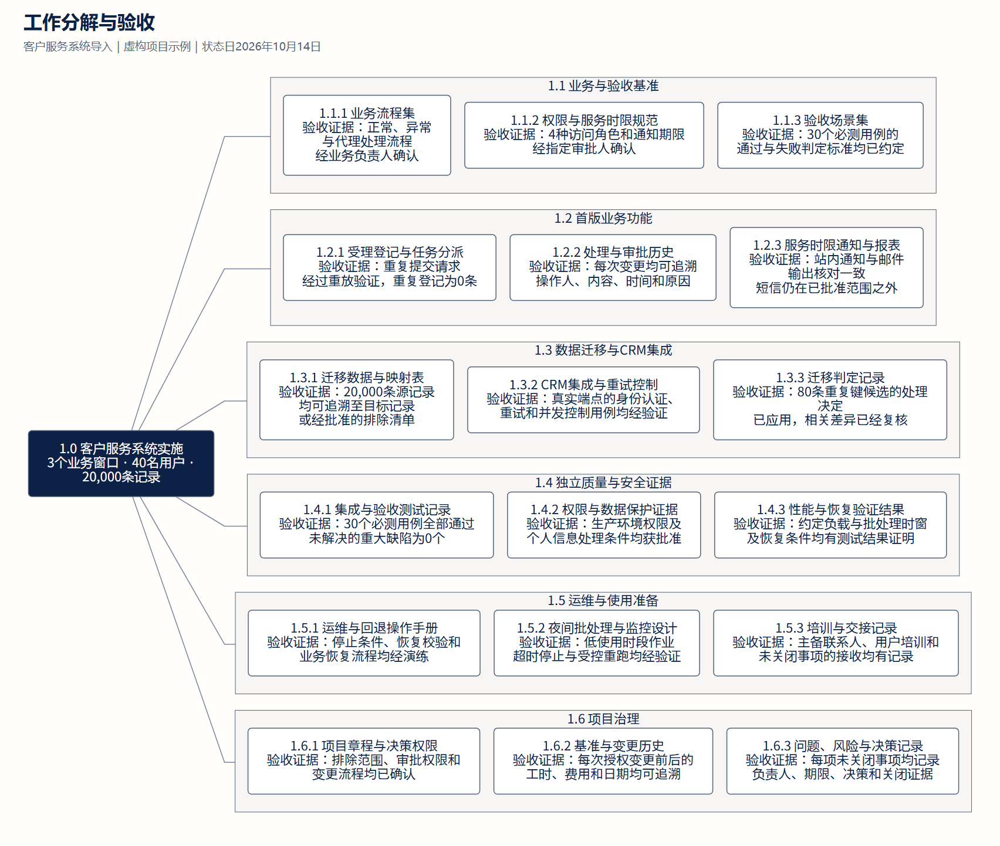
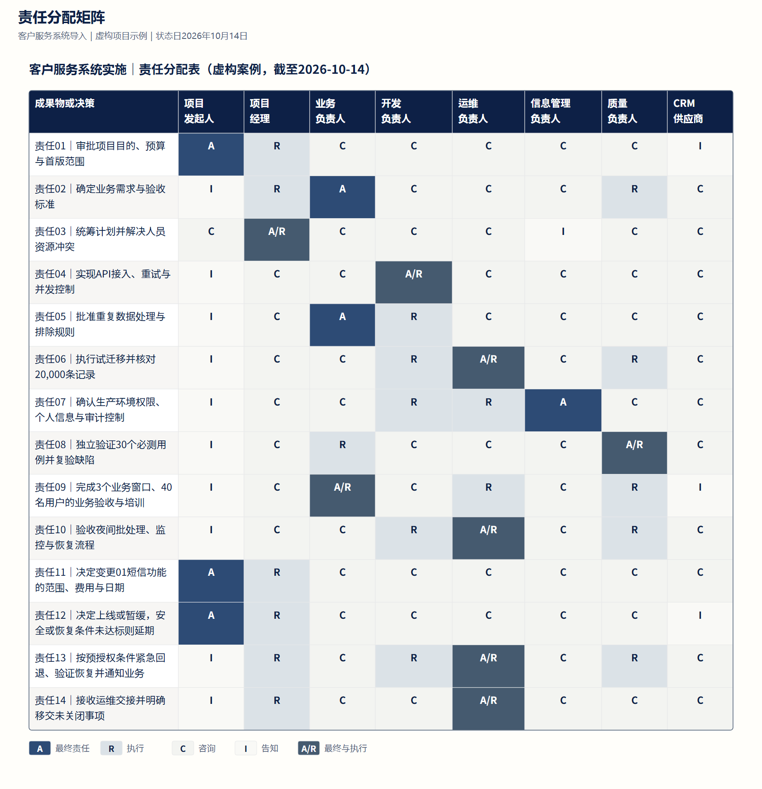
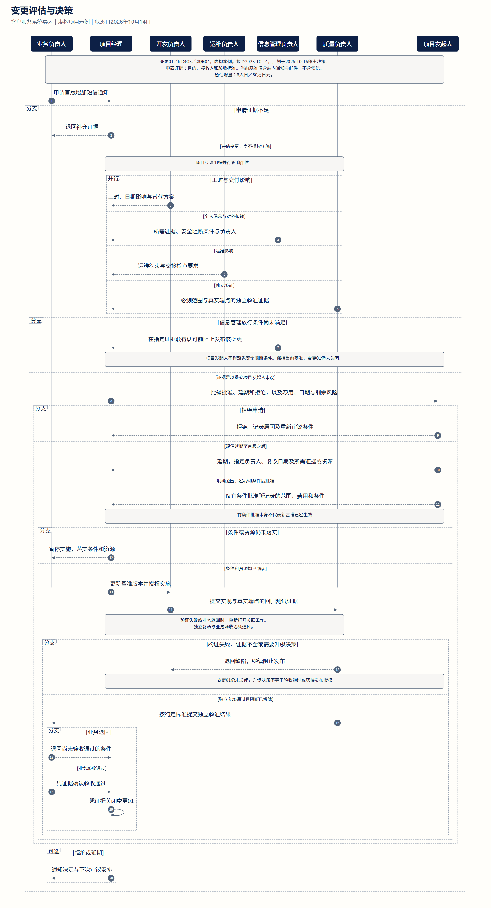
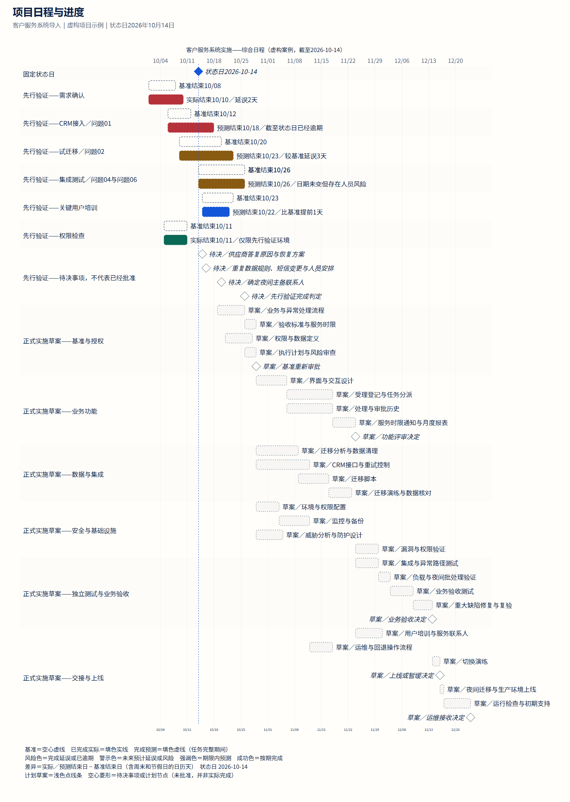

# 把项目材料变成团队能用的图表

[项目理念与使用](../README.zh-CN.md) · [下载中文图表工作包](https://github.com/dfzzq719/taskobo-diagrams/raw/refs/heads/main/docs/downloads/taskobo-diagrams-examples-zh-CN.zip)

同一个虚构的客户服务系统导入项目，用四种图表帮助团队确认范围、责任、变更和日期。点击图片查看大图。

[工作分解](#范围与验收) · [责任分配](#决策与执行) · [变更流程](#变更授权) · [项目日程](#交付日期)

## 范围与验收

**工作分解**：把工作拆成可交付、可验收的成果物。

[下载图片](assets/crm-case/zh-CN/wbs-figure.png) · [可编辑源文件](../examples/project-case/zh-CN/wbs.mmd)

## 决策与执行

**责任分配**：明确谁拍板、谁执行、谁参与咨询、谁需要知情。

[下载图片](assets/crm-case/zh-CN/raci-figure.png) · [可编辑源文件](../examples/project-case/zh-CN/raci.json)

## 变更授权

**变更流程**：让范围调整经过评估、授权、复验和验收。

[下载图片](assets/crm-case/zh-CN/workflow-figure.png) · [可编辑源文件](../examples/project-case/zh-CN/change-control.mmd)

## 交付日期

**项目日程**：分清计划、已完成与预计完成，及时看见偏差。

[下载图片](assets/crm-case/zh-CN/gantt-figure.png) · [可编辑源文件](../examples/project-case/zh-CN/schedule.mmd)
